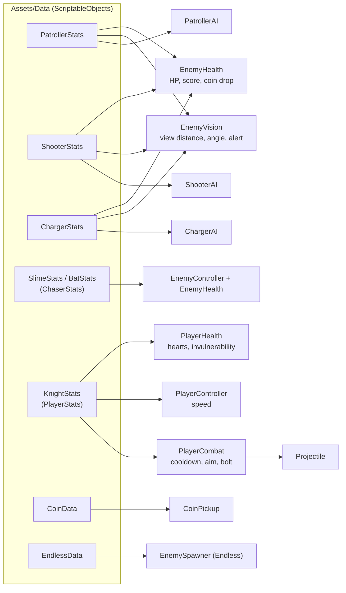
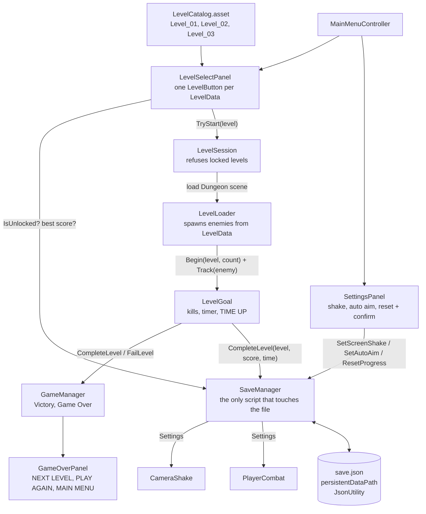

# Script map: data and saves (Assignment 11)

A picture of the same map for the video is in `Submission/A11_Script_Map.png`.

## 1. Balance data → gameplay components



Class tree of the data:

```
ScriptableObject
├── EnemyStats            maxHealth, scoreValue, coinDropChance
│   ├── ChaserStats       Slime, Bat: speed, contact damage, cooldown
│   └── SightedEnemyStats vision + fair-play grace and screen margin
│       ├── PatrollerStats
│       ├── ShooterStats
│       └── ChargerStats
├── PlayerStats           Knight: hearts, speed, fire rate, bolt
├── CoinData              points, magnet, lifetime
├── EndlessData           Endless waves: types, weights, pacing
├── LevelData             one level: enemies, positions, routes, delays, time limit
└── LevelCatalog          the ordered list of LevelData (Assets/Resources)
```

What stays in the components: only feel and technical values (colours, screen shake strength, telegraph look, steering and stuck checks). They do not change how hard the game is.

## 2. Levels, progress and saving



## 3. SaveManager in one picture

| When | What happens |
|---|---|
| App start (`BeforeSceneLoad`) | `SaveManager` creates itself (`DontDestroyOnLoad`) and calls `Load()` |
| `Load()` | missing → defaults · empty / broken JSON / not an object → copy to `save.broken.json`, defaults · `version` newer than 1 → incompatible, copy, defaults · `version` 0 or missing → invalid, copy, defaults · valid → `Validate()` repairs out-of-range levels, duplicates, negative scores |
| After a win | `LevelGoal` → `SaveManager.CompleteLevel` → completed, next level unlocked, best score and time → `Save()` |
| Settings change | `SetScreenShake` / `SetAutoAim` → `Save()` |
| Reset Progress | confirm panel → `ResetProgress()` keeps settings → `Save()` |
| App goes to background | `OnApplicationPause(true)` → `Save()` (also `OnApplicationQuit`) |
| `Save()` | writes `save.json.tmp`, then replaces `save.json` (a crash during writing cannot leave half a file) |

`save.json` example (real file written by the automated test after winning Level 1):

```json
{
    "version": 1,
    "unlockedLevels": [1, 2],
    "completedLevels": [1],
    "bestScores": [{ "level": 1, "bestScore": 1200, "bestTime": 1.10 }],
    "settings": { "screenShake": false, "autoAim": true }
}
```

(The real file is pretty-printed with one value per line. The test killed all enemies at once, so the time is very short.)

## 4. Files

| Area | Files |
|---|---|
| Balance data classes | `Assets/Scripts/Data/EnemyStats.cs`, `SightedEnemyStats.cs`, `PatrollerStats.cs`, `ShooterStats.cs`, `ChargerStats.cs`, `ChaserStats.cs`, `PlayerStats.cs`, `CoinData.cs`, `EndlessData.cs` |
| Level data classes | `Assets/Scripts/Data/LevelData.cs` (with `EnemySpawn`), `LevelCatalog.cs` |
| Level flow | `Assets/Scripts/Core/LevelSession.cs`, `LevelLoader.cs`, `LevelGoal.cs`, `TryCounter.cs`, `GameManager.cs`, `Assets/Scripts/Enemies/ILevelEnemy.cs` |
| Saves | `Assets/Scripts/Save/SaveData.cs`, `SaveManager.cs` |
| UI | `Assets/Scripts/UI/LevelSelectPanel.cs`, `LevelButton.cs`, `SettingsPanel.cs`, `MainMenuController.cs`, `GameOverPanel.cs`, `HudController.cs` |
| Assets | `Assets/Data/Enemies/*.asset`, `Assets/Data/Player/KnightStats.asset`, `Assets/Data/Items/CoinData.asset`, `Assets/Data/Endless/EndlessData.asset`, `Assets/Data/Levels/Level_01..03.asset`, `Assets/Resources/LevelCatalog.asset` |
