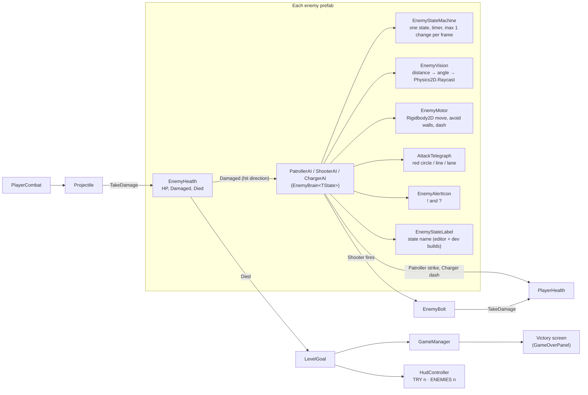
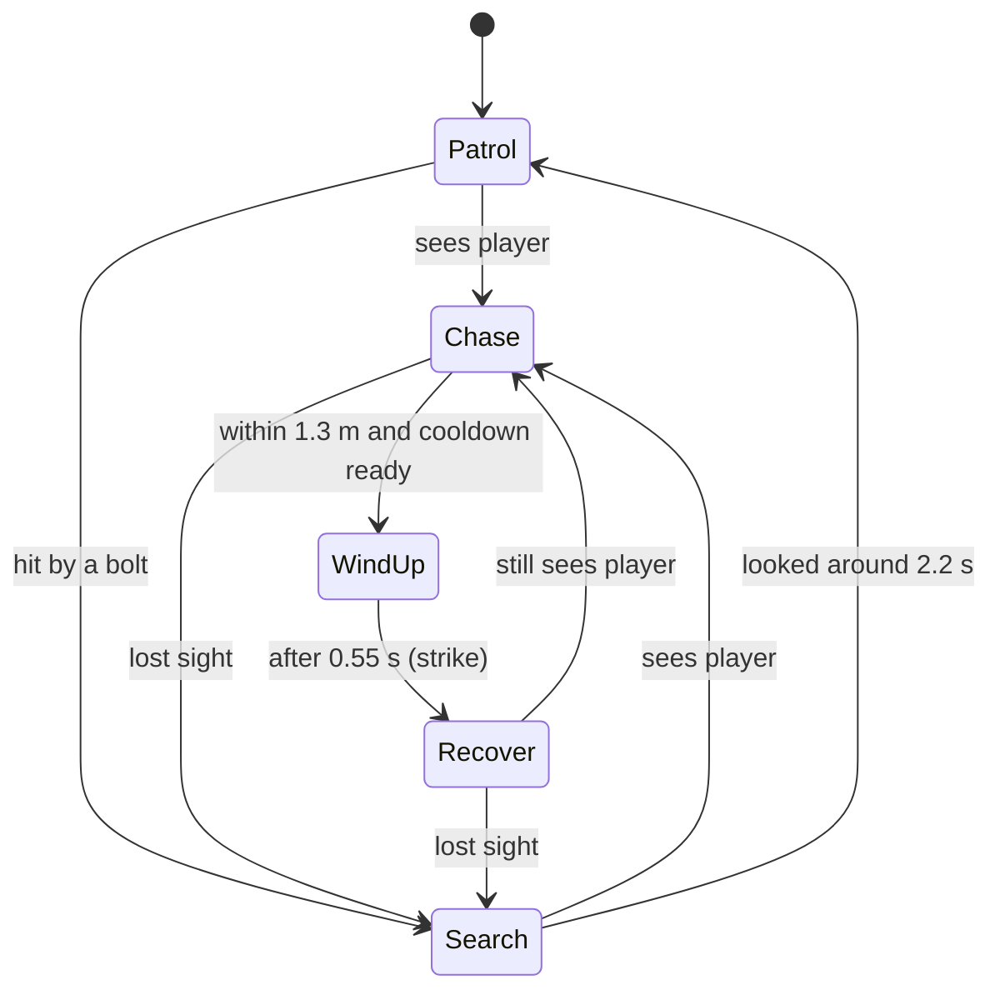
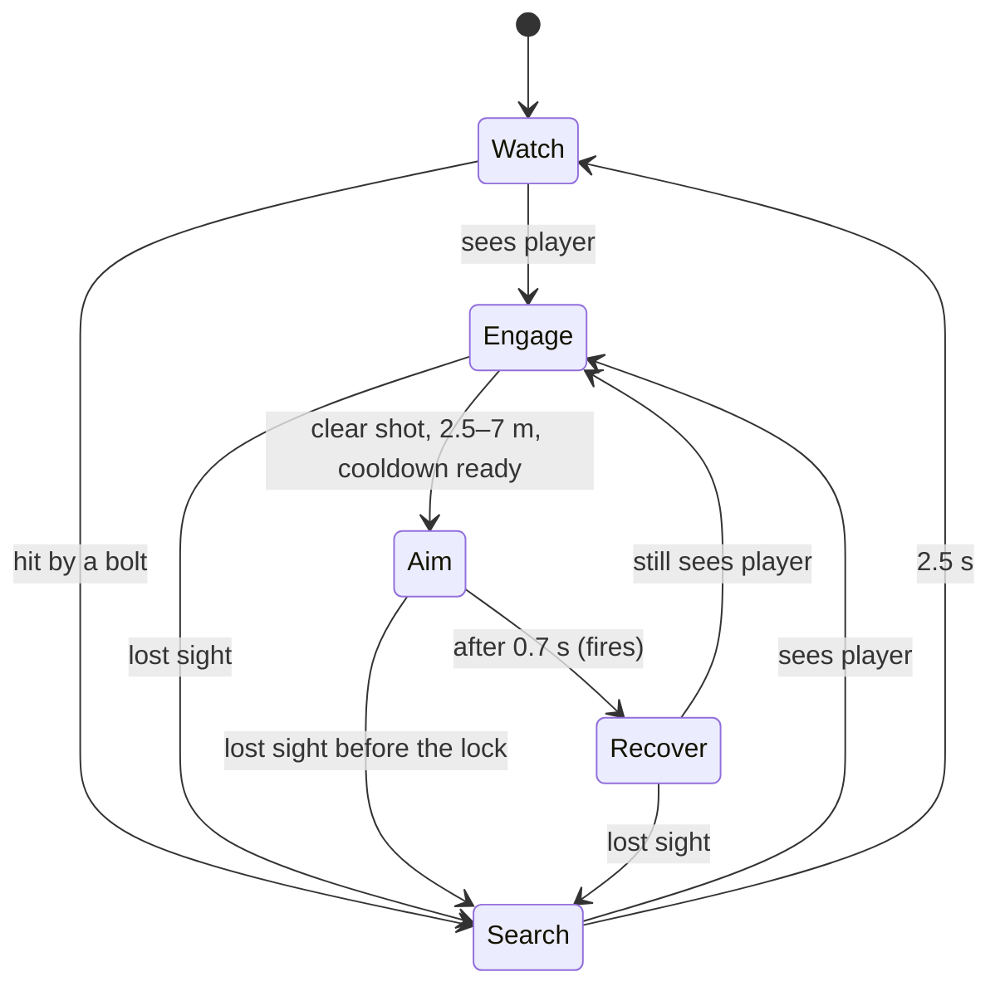
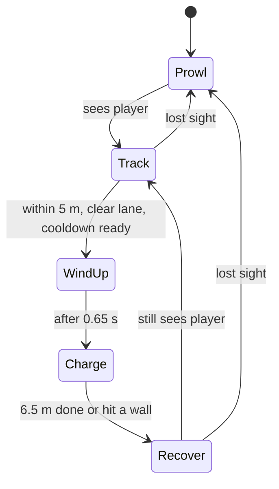

# Script map: three enemy types (Assignment 10)

A picture of the same map for the video is in `Submission/RK2_Script_Map.png`.

## Which scripts talk to which

Shared code is only the plumbing (state machine, movement, vision, warnings, icons). Each enemy decides in its own script, so the three behave differently.

## Patroller (`PatrollerAI.cs`)

| State | What it does |
|---|---|
| Patrol | Walks between waypoints at 1.4 m/s and pauses 0.6 s at each one. |
| Chase | Runs at 2.6 m/s toward the player (the player runs at 5 m/s). |
| WindUp | Stops, turns red, and a red circle fills for 0.55 s. |
| Recover | Strikes once (only if the player is still in the circle and not behind a wall), then waits 0.45 s. Cooldown 1.1 s. |
| Search | Walks to the last known spot, or toward a shot, shows "?" and looks around for 2.2 s. |

Sight: 5.5 m, 110° cone, raycast. Tests the player's **positioning**: stay out of the cone and use pillars as cover.

## Shooter (`ShooterAI.cs`)

| State | What it does |
|---|---|
| Watch | Guards its post and sweeps its view left and right. |
| Engage | Keeps distance: backs away under 2.5 m, walks closer over 7 m, steps sideways if a pillar blocks the shot. |
| Aim | 0.7 s: a red line follows the player, then turns yellow and locks for the last 0.25 s. |
| Recover | Fires one magenta bolt (6.5 m/s) and waits 0.4 s. Cooldown 1.8 s. |
| Search | Looks toward the last known spot for 2.5 s, then walks back to its post. |

Sight: 7.5 m, 120° cone, raycast. Walls stop the bolt. Tests the player's **reaction**: step aside when the line turns yellow.

## Charger (`ChargerAI.cs`)

| State | What it does |
|---|---|
| Prowl | Walks around its home in a fixed pattern. If hit, it stops and looks toward the shot for 1.2 s. |
| Track | Turns to the player and comes closer (stops at 4 m). |
| WindUp | 0.65 s: the direction locks, a wide red lane shows the path, and the body shakes and turns red. |
| Charge | Dashes at 11 m/s in a straight line. It can hit only once per dash. |
| Recover | Stunned and blue for 0.8 s (1.0 s after hitting a wall). Cooldown 2.0 s. |

Sight: 6 m, 100° cone, raycast. Tests the player's **timing**: step out of the lane, then hit it while it is stunned.

## Rules shared by all three

- Every attack has a visible wind-up between 0.3 and 0.8 s, then a recovery and a cooldown.
- No attack in the first 1.5 s of the level, and no attack while the enemy or the player is off-screen.
- Sight is checked every 0.1 s, not every frame.
- A hit turns the enemy toward the shot. For 3 s it can see 1.6 times farther, but walls still block its sight.
- No damage after death: a dead enemy stops thinking in the same frame.
